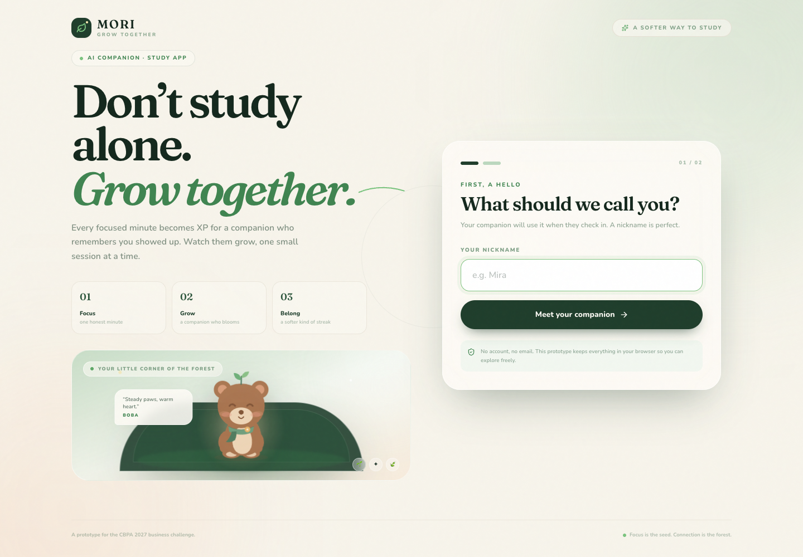
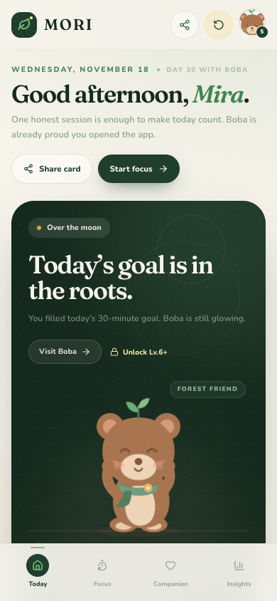
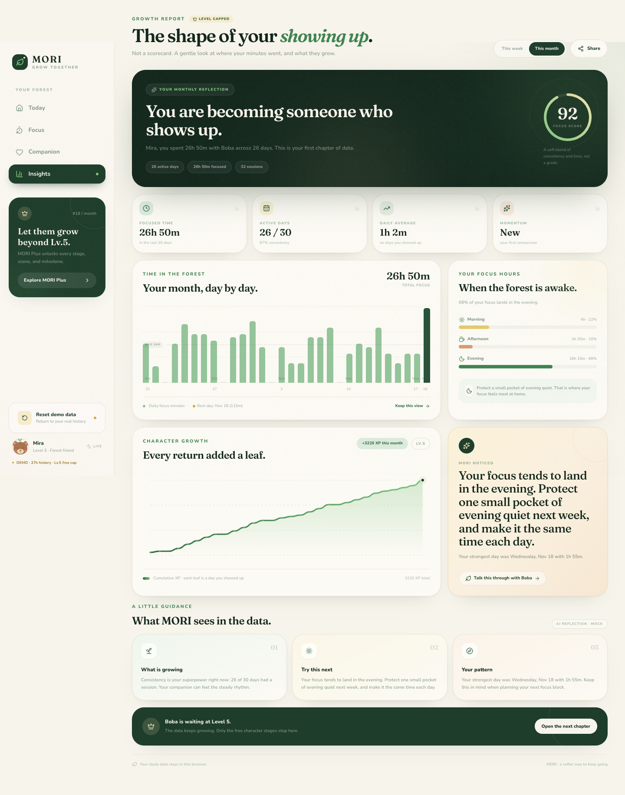

# MORI · Don't study alone. Grow together.

> **The hypothesis:** when focused study time becomes visible growth for a virtual companion, users form a stronger emotional bond — and come back more often.
>
> This prototype tests one complete loop: **focus → grow → feel something → return.** AI replies and payment are mocked behind real interfaces, so both can be replaced without rebuilding the product.

**Live demo:** https://moricompanion.netlify.app/



## What is in the prototype

| Area | What it does |
| --- | --- |
| **Onboarding** | Nickname + one of three illustrated companions: Boba the bear, Fenn the deer, Miso the fox. |
| **Today** | XP bar, level, streak, daily goal, mood, weekly rhythm, today's sessions, and a personalized note from the companion. |
| **Focus room** | 25/45/60-minute and custom Pomodoro timer, 5/10/15-minute breaks, animated study/rest poses, pause/resume, early finish with banked minutes, and completion celebration. |
| **Companion** | Full character stage, growth timeline, unlockable abilities, mood states, and a scene-aware chat interface. |
| **Insights** | Week/month filters, daily bar chart, time-of-day focus pattern, cumulative growth curve, focus score, and data-aware AI-style recommendations. |
| **MORI Plus** | Free accounts cap at **Level 5**. A simulated ¥18/month paywall unlocks every future stage and triggers a level-up celebration. |
| **Share card** | Generates a real PNG growth card with the companion, level, stage, streak, and stats. Supports native share when available and download everywhere else. |
| **Demo Mode** | One click fills 30 days of deterministic study history for a pitch. Your real history is backed up and restored when the demo is reset. |
| **Analytics** | A visible event log in the browser console covering acquisition, activation, engagement, conversion, retention, and sharing events. |

### Desktop and mobile

<p align="center">
  
  
</p>

## Run it locally

The fastest way to see MORI is the live demo: **https://moricompanion.netlify.app/** — it runs entirely in the browser, so no install is required.

To run it locally, you need **Node.js 18+** and npm:

```bash
npm install
npm run dev
```

Open the URL printed by Vite — normally **http://localhost:5173**.

Production build:

```bash
npm run build
npm run preview
```

No environment variables are required. Without an LLM endpoint, the companion uses the built-in mock reply engine.

## The growth loop (core product logic)

All commercial rules live in `src/lib/constants.js`, `src/lib/progression.js`, and `src/lib/mood.js`.

| Rule | Implementation |
| --- | --- |
| XP earned | **1 focused minute = 2 XP** (`XP_PER_MINUTE`). Break time earns no XP. |
| Level curve | Cumulative XP to reach level `n` = `50 × (n − 1) × n`. The next level always needs **100 × current level** more XP. |
| Free cap | Free accounts stop at **Level 5** (`FREE_LEVEL_CAP`). Extra XP still accumulates and is revealed after upgrading. |
| Premium | Simulated ¥18/month. Removes the cap and unlocks premium abilities/scenes. |
| Daily goal | Default 30 minutes, editable in the Today page. Hitting it changes the companion to **Over the moon**. |
| Streak | Consecutive local calendar days with at least one focus session. A streak survives until the end of today even before today's session. |
| Companion moods | Daily goal met → **Over the moon** · any focus today → **In the zone** · 3+ days away → **Missing you** · late night → **A little sleepy** · otherwise **Ready when you are**. |
| Character state | Derived from study data and displayed through copy, facial expression, pose, and animation. Nothing is a fake static state. |
| Demo Mode | Generates 29 days of sessions + today, with realistic missed days. It does **not** silently grant Premium: the Level 5 cap is visible, and unlocking Plus demonstrates the full advanced form. |


The companion page combines the full character stage, a data-driven growth timeline, unlockable abilities, and a scene-aware chat:


## Replace the mock AI with a real LLM

The mock lives in [`src/lib/companionAI.js`](src/lib/companionAI.js) inside `generateCompanionReply(userMessage, studyData)`. It already:

- reads the user's level, streak, minutes today, goal, mood, and days away;
- detects intent in the message (tired, stuck, overwhelmed, wins, greetings, and more);
- replies with one of 20+ personality-consistent lines;
- simulates typing latency.

### Step 1 — create a server-side proxy

**Never put a provider API key in a `VITE_*` variable.** Those values are shipped to the browser. Create a tiny server endpoint (Vercel/Netlify/Express) that holds the key.

Contract expected by the prototype:

```http
POST /api/companion
Content-Type: application/json

{
  "systemPrompt": "...",
  "messages": [{ "role": "user", "content": "I feel stuck today" }],
  "context": { "nickname": "Mira", "level": 5, "streak": 9, "...": "..." }
}
```

Respond with:

```json
{ "reply": "Stuck usually means the next step is too big..." }
```

### Step 2 — point the app at your proxy

Copy `.env.example` to `.env` and set:

```bash
VITE_MORI_LLM_ENDPOINT=https://your-domain.com/api/companion
```

Or use a relative path with a Vite dev proxy:

```js
// vite.config.js
server: {
  proxy: {
    '/api': 'http://localhost:3001',
  },
}
```

If the endpoint is configured but fails or times out, the app automatically falls back to the mock reply — a useful safety net during a live demo.

### Example proxy (Node / Vercel style, OpenAI)

```js
// api/companion.js — SERVER SIDE ONLY
export default async function handler(req, res) {
  const { systemPrompt, messages } = req.body;

  const response = await fetch('https://api.openai.com/v1/chat/completions', {
    method: 'POST',
    headers: {
      'Content-Type': 'application/json',
      Authorization: `Bearer ${process.env.OPENAI_API_KEY}`,
    },
    body: JSON.stringify({
      model: 'gpt-4o-mini',
      temperature: 0.8,
      messages: [{ role: 'system', content: systemPrompt }, ...messages],
    }),
  });

  const data = await response.json();
  res.status(200).json({ reply: data.choices[0].message.content });
}
```

The same seam works with Claude, Gemini, or a self-hosted model. The existing `buildSystemPrompt(context)` function is a reasonable starting personality: warm, specific, 1–3 sentences, never shaming missed days, and never using corporate productivity language.

## Data model and persistence

The prototype deliberately avoids a database. State is stored in `localStorage` under `mori.state.v1`:

```js
{
  version: 1,
  user: {
    id, nickname, characterType, companionName,
    level, xp, streak, totalMinutes, dailyGoal,
    premium, premiumSince, createdAt, lastStudyAt
  },
  sessions: [
    { id, userId, type: 'focus' | 'break', duration, startTime, endTime, xpEarned }
  ],
  chat: [
    { id, role: 'user' | 'assistant', text, createdAt, meta }
  ],
  demoLoaded: false,
  demoBackup: null
}
```

`Character` and `streak`/`mood` state are derived selectors rather than duplicated records. To reset the prototype, run this in the browser console:

```js
localStorage.removeItem('mori.state.v1');
location.reload();
```

## Analytics

Open the browser console and look for styled `MORI` events. Events are also available at `window.__MORI_EVENTS__` and in `sessionStorage` under `mori.events`.

Tracked events include:

`app_opened`, `onboarding_started`, `character_selected`, `onboarding_completed`, `focus_started`, `focus_paused`, `focus_resumed`, `focus_completed`, `focus_ended_early`, `break_started`, `break_completed`, `session_abandoned`, `level_up`, `level_cap_reached`, `daily_goal_reached`, `paywall_viewed`, `premium_clicked`, `premium_unlocked`, `demo_loaded`, `demo_reset`, `chat_opened`, `chat_message_sent`, `companion_replied`, `report_viewed`, `range_changed`, `share_opened`, `share_downloaded`, `share_clicked`, `goal_updated`.

This is intentionally a demo-grade event stream. In production, replace `src/lib/analytics.js` with your product analytics SDK or a server endpoint.

## Share card

`src/components/ShareModal.jsx` renders a 3:4 growth card at 3× pixel ratio with `html-to-image` and downloads it as a PNG. It uses the Web Share API when the browser can share files and falls back to download + clipboard caption. Everything happens locally; no image or study data leaves the browser.



## Project structure

```text
mori-companion/
├── src/
│   ├── components/
│   │   ├── AppShell.jsx          # Sidebar, mobile nav, demo control
│   │   ├── CompanionArt.jsx      # Original SVG companion artwork & poses
│   │   ├── LevelUpOverlay.jsx    # Premium level-jump celebration
│   │   ├── Modal.jsx
│   │   ├── PaywallModal.jsx      # Simulated MORI Plus checkout
│   │   ├── ShareModal.jsx        # PNG growth card generation
│   │   └── UI.jsx                # Avatar, XP bar, mood, toast, confetti
│   ├── context/MoriContext.jsx   # Persistent state + all product actions
│   ├── lib/
│   │   ├── analytics.js          # Console event stream
│   │   ├── companionAI.js        # Mock AI + LLM proxy seam
│   │   ├── constants.js          # Characters, XP rules, price, perks
│   │   ├── demo.js               # Deterministic 30-day demo generator
│   │   ├── insights.js           # Report + recommendation generation
│   │   ├── mood.js               # Emotional state logic
│   │   └── progression.js        # XP curve, levels, streaks, timeline
│   ├── pages/
│   │   ├── WelcomePage.jsx
│   │   ├── DashboardPage.jsx
│   │   ├── FocusPage.jsx
│   │   ├── CompanionPage.jsx
│   │   └── ReportPage.jsx
│   ├── App.jsx
│   ├── main.jsx
│   └── index.css
├── docs/                         # Screenshots used in this README
├── .env.example
└── README.md
```

## 3-minute pitch flow

1. **Welcome** — enter a name, choose Boba, and feel the tone of the product in under 20 seconds.
2. **Demo Mode** — load 30 days of history with one click. The streak, weekly rhythm, and full report immediately become presentation-ready.
3. **Insights → This month** — walk through the study rhythm, evening focus pattern, growth curve, and AI reflections.
4. **MORI Plus** — point out the Level 5 cap. Simulate the ¥18/month unlock. The level jump from 5 → 8 is the emotional and commercial climax.
5. **Share card** — download the growth card and show how the emotional bond becomes an acquisition loop.
6. **Console** — show the live `MORI` analytics events to reinforce a data-driven product process.

## Known limitations / next steps

- AI replies are mocked until you provide a server-side LLM proxy.
- Payment is simulated; no card is collected and no real charge is made.
- Persistence is local-only. A production build needs auth, a database, cross-device sync, and server-side entitlement checks.
- The tier currently uses a single monthly plan. Real pricing should test monthly vs. annual, regional pricing, and a free trial.
- Analytics are console-only for demo transparency. Production should use a privacy-respecting event pipeline.
- The share card uses system fonts if the browser blocks bundled webfonts in screenshot rendering; it still generates correctly.

---

**MORI** is a commercial prototype built with React, Vite, and Tailwind CSS. The illustrations are original inline SVG; no third-party image assets are used. All interface copy is in English.
